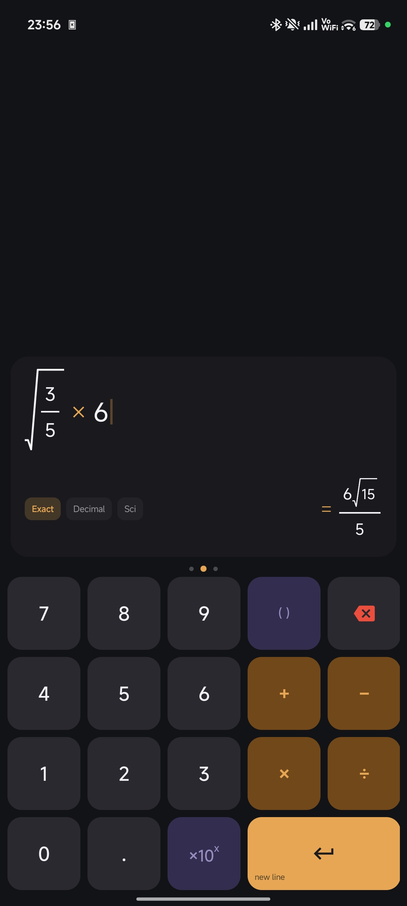
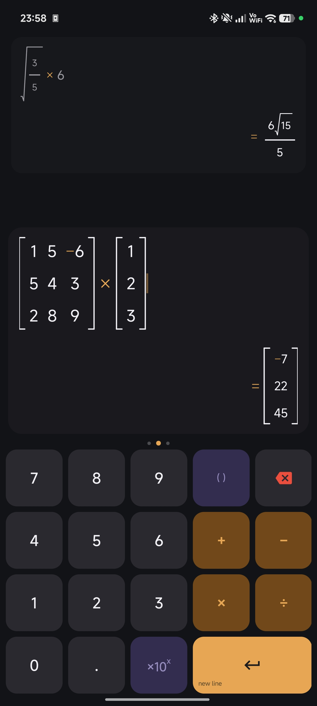
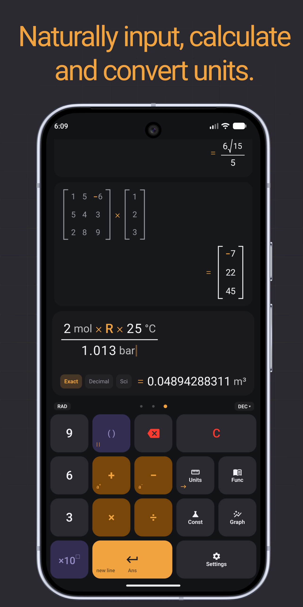
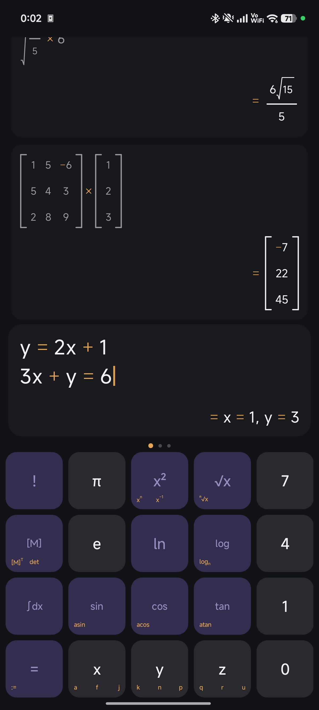
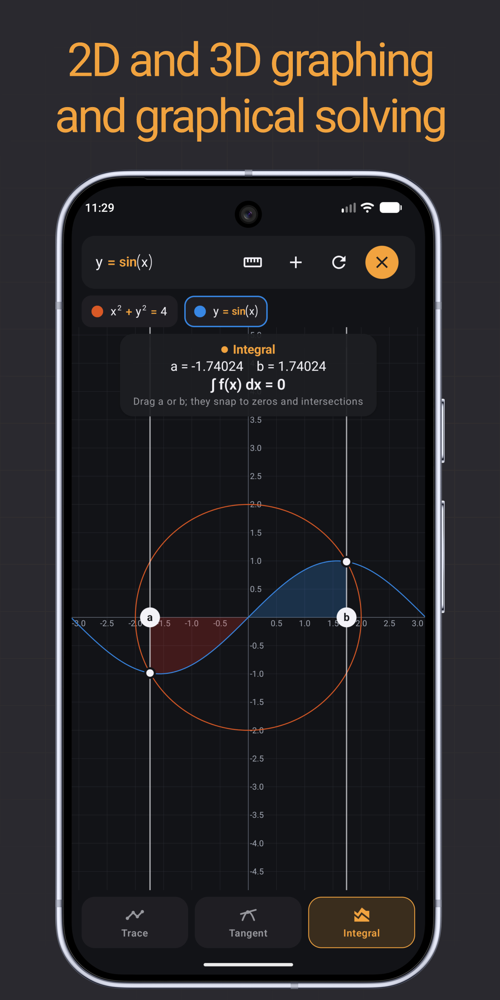

# Calculator

[](LICENSE.md)
[](https://developer.android.com)
[](https://ko-fi.com/pcmciakai)

A free and open-source scientific calculator for Android with natural math input, unit conversion, physical constants, matrices, equation solving and a graph plotter.

## Features

- **Natural display:** Fractions, exponents, roots and integrals rendered as proper math notation while you type
- **Scientific functions:** Trigonometric functions with their reciprocals (sec, csc, cot), hyperbolic functions, all their inverses, logarithms, factorials, n-th roots
- **Variables and functions:** Define your own variables and reuse them, also reuse the last result with 'Ans'
- **Equation solving:** Single equations and systems of linear equations
- **Matrices:** Transpose, inverse and determinant
- **Numeric integration:** Definite integrals
- **Units:** Calculate and convert across 18 categories (length, mass, energy, pressure, temperature, electricity, …) with metric, imperial or US customary result preferences
- **Constants:** Searchable library of mathematical and physical constants
- **Graph plotter:** 2D plots of functions and implicit curves
- **Display options:** Fixed or automatic decimal places, digit grouping, light/dark/system theme

No ads, no tracking, no network access.

## Screenshots

<p align="center">
  
  
  
  
  
</p>

## Requirements

- Android 11 (API 30) or newer

## Building

The project uses Gradle with the included wrapper and requires JDK 17 or newer.

```sh
# Debug build
./gradlew assembleDebug

# Release build (unsigned)
./gradlew assembleRelease

# Run unit tests
./gradlew test
```

The APK is written to `app/build/outputs/apk/`.

## AI Disclosure

The majority of this project's source code was written with the help of AI tools. Because the code is largely AI-generated, it builds on the collective work of countless developers who share their knowledge openly — and it should give back in the same way. For this reason, this project is and must always remain open source.

## License

Copyright (C) 2026 PcmciaKai

This program is free software: you can redistribute it and/or modify it under the terms of the GNU General Public License as published by the Free Software Foundation, either version 3 of the License, or (at your option) any later version.

This program is distributed in the hope that it will be useful, but WITHOUT ANY WARRANTY; without even the implied warranty of MERCHANTABILITY or FITNESS FOR A PARTICULAR PURPOSE. See [LICENSE.md](LICENSE.md) for details.
