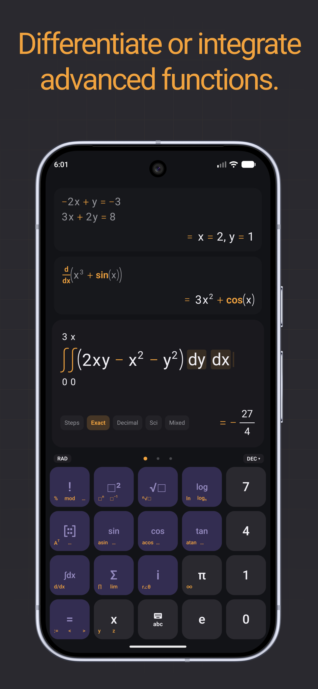
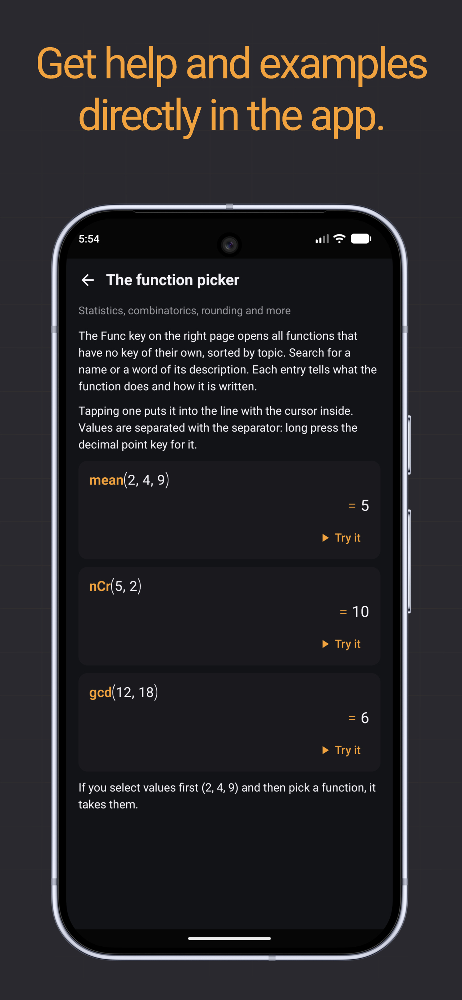

# Arithmeticus Calculator

[](LICENSE.md)
[](https://developer.android.com)
[](https://ko-fi.com/pcmciakai)

A free and open-source scientific calculator for Android with natural math input, exact results and step-by-step solutions. It solves equations, differentiates and integrates, works with matrices, units and complex numbers, and draws 2D and 3D graphs.

## Features

- **Natural display:** Fractions, exponents, roots, integrals and matrices rendered as proper math notation while you type, with tap-to-place cursor, selection, copy and paste
- **Live results:** The result is worked out while you type; exact where possible (fractions, roots, π) and switchable to decimal, scientific, mixed number, polar or HEX/OCT/BIN form
- **Step-by-step solutions:** Each step with the rule that was used, for equations, systems, inequalities, derivatives, integrals, limits, matrices, Taylor polynomials, differential equations and more
- **Equations and inequalities:** Single equations, linear and many non-linear systems, inequalities with interval notation and number line
- **Calculus:** Derivatives (also at a point and partial), antiderivatives and definite integrals (numeric when there is no formula), sums, products, limits (also one-sided), Taylor polynomials
- **Differential equations:** First-order linear and separable, and second-order linear equations with constant coefficients, with or without initial conditions
- **Matrices and vectors:** Determinant, inverse, transpose, row reduction (rref), eigenvalues and eigenvectors; dot and cross product, norm, angle, projection and unit vector
- **Complex numbers:** Rectangular and polar form (r∠θ), re, im, arg and conj
- **Scientific functions:** Trigonometric functions with their reciprocals, hyperbolic functions, all their inverses, logarithms to any base, factorials, Γ, n-th roots, modulo
- **Function picker:** Searchable list of further functions for statistics, combinatorics, probability distributions, rounding and number theory, random numbers and special functions
- **Variables:** x, y, z and any other lower-case letter; store values, matrices and vectors with `:=` and reuse the last result with `Ans`
- **Units:** Calculate and convert across 18 categories (length, mass, energy, pressure, temperature, electricity, …) with metric, imperial or US customary result preferences
- **Constants:** Searchable library of mathematical and physical constants with their units
- **Graph plotter:** Functions, implicit curves, parametric lines and 3D surfaces; points snap to zeros, extrema, inflection points and intersections; trace, tangent and area tools; logarithmic axes and polar coordinates
- **Programmer mode:** Hexadecimal, octal and binary input with bitwise operations and shifts
- **History and sessions:** Reuse, copy or delete earlier calculations, with undo; save a session to a text file and open it again
- **In-app help:** Searchable guide to every key and function, with examples you can put straight into the line
- **Languages:** English, German, French, Spanish, Russian and Simplified Chinese
- **Display options:** Fixed or automatic decimal places, digit grouping, point or comma as decimal separator, light/dark/system theme, three-page keypad that is shown side by side on tablets and foldables

No ads, no tracking, no network access.

## Inspiration

This app was originally inspired by the design and handling of the [Archimedes Calculator](https://www.archimedescalculator.com/) and by the step-by-step solutions of the [HiPER Scientific Calculator](https://hiperlabs.eu/).

## Screenshots

<p align="center">
  
  
  
  
  
  
  
</p>

## Requirements

- Android 11 (API 30) or newer

## Building

The project uses Gradle with the included wrapper and requires JDK 17 or newer.

```sh
# Debug build
./gradlew assembleDebug

# Release build (unsigned)
./gradlew assembleRelease

# Run unit tests
./gradlew test
```

The APK is written to `app/build/outputs/apk/`.

## AI Disclosure

The majority of this project's source code was written with the help of AI tools. Because the code is largely AI-generated, it builds on the collective work of countless developers who share their knowledge openly — and it should give back in the same way. For this reason, this project is and must always remain open source.

## License

Copyright (C) 2026 PcmciaKai

This program is free software: you can redistribute it and/or modify it under the terms of the GNU General Public License as published by the Free Software Foundation, either version 3 of the License, or (at your option) any later version.

This program is distributed in the hope that it will be useful, but WITHOUT ANY WARRANTY; without even the implied warranty of MERCHANTABILITY or FITNESS FOR A PARTICULAR PURPOSE. See [LICENSE.md](LICENSE.md) for details.
